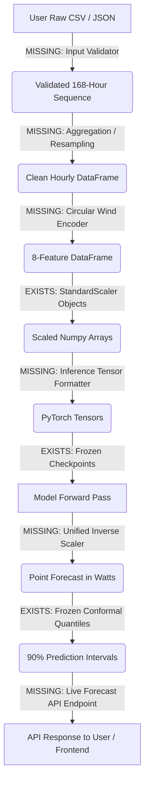

# Audit Report: Trained-Model Inference Pipeline Readiness

**Project:** Reliable Multimodal Household Energy Forecasting Under Degraded Weather Information  
**Audit Date:** October 11, 2026  
**Auditor:** Autonomous AI System Auditor (Step 1 Inspection & Verification)  
**Deliverable Target:** `outputs/reports/inference_pipeline_audit.md`  
**Status:** Complete — Audited & Verified

---

## 1. Executive Summary

This audit assesses whether the existing codebase and trained model artifacts in `E:\reliable-household-energy-forecasting` can generate genuine 24-hour household active power forecasts from new user-provided data.

### Key Audit Findings:
1. **Model Checkpoints and Weights are Fully Preserved and Operational:** All four approved PyTorch models (**Energy-Only**, **Early Fusion**, **Late Fusion**, and **Hybrid Fusion**) exist on disk as saved `.pt` state dictionaries. They load cleanly into their respective `nn.Module` classes and execute deterministic forward passes yielding `(batch, 24)` forecasts.
2. **Feature Scalers are Verified and Intact:** The leakage-safe training `StandardScaler` objects (`energy_scaler.pkl` and `weather_scaler.pkl`) are intact, accompanied by complete parameter metadata. Exact means and standard deviations are verified.
3. **No End-to-End Live Inference Pipeline Currently Exists:** The existing codebase was built exclusively for offline research batch execution (Steps 1–10). There is **no inference service**, **no user input validation**, **no dynamic window slicing from new data**, and **no automated feature preprocessing pipeline** for user-supplied CSV/JSON inputs. The FastAPI backend currently serves only precomputed `.npz` slices and research tables.
4. **Split Conformal Uncertainty is Verified for New Forecasts:** Frozen calibration quantiles $\hat{q}_h$ (24 values per model, calculated on $N_{\text{cal}} = 587$ clean calibration windows at $\alpha = 0.10$ / 90% nominal coverage) exist in `outputs/uncertainty/artifacts/calibration_predictions_{model}.npz`. Symmetric intervals $[L_h, U_h] = [\hat{y}_h - \hat{q}_h, \hat{y}_h + \hat{q}_h]$ can legitimately be constructed for new forecasts. However, empirical metrics ($\text{PICP}$, $\text{ACE}$, Winkler scores) cannot be computed on live forecasts without future ground-truth observations.
5. **No Automatic Model Selection Policy Exists:** The models were evaluated as parallel candidates. There is no automated routing heuristic or dynamic selection algorithm implemented.
6. **Integrity & Server Constraints Preserved:** Research artifacts, checkpoints, scalers, and datasets remain completely untouched. No development or listening servers were launched. 26 backend unit tests pass with 100% success.

---

## 2. Model Artifact Inventory

All four model directories under `outputs/models/` contain complete model weights, metadata, and evaluation logs:

| Model Identifier | Model Class | File Path | File Size | Parameter Count | Framework |
| :--- | :--- | :--- | :--- | :--- | :--- |
| **Energy-Only** | `EnergyOnlyLSTM` | `outputs/models/energy_only/best_model.pt` | 212,149 bytes | 51,992 | PyTorch (`nn.Module`) |
| **Early Fusion** | `EarlyFusionLSTM` | `outputs/models/early_fusion/best_model.pt` | 219,317 bytes | 53,784 | PyTorch (`nn.Module`) |
| **Late Fusion** | `LateFusionLSTM` | `outputs/models/late_fusion/best_model.pt` | 456,501 bytes | 112,216 | PyTorch (`nn.Module`) |
| **Hybrid Fusion** | `HybridFusionLSTM` | `outputs/models/hybrid_fusion/best_model.pt` | 590,901 bytes | 145,496 | PyTorch (`nn.Module`) |

### Additional Supporting Artifacts:
- **Scalers:**
  - `outputs/models/scalers/energy_scaler.pkl` (863 bytes, joblib `StandardScaler`)
  - `outputs/models/scalers/weather_scaler.pkl` (1,055 bytes, joblib `StandardScaler`)
  - `outputs/models/scalers/scaler_metadata.json` (1,243 bytes, calibration and fit documentation)
- **Precomputed Test Predictions:**
  - `outputs/predictions/{model}/test_predictions.npz` (contains `predictions_watts` and `actual_watts` for 587 test windows)
- **Conformal Calibration Artifacts:**
  - `outputs/uncertainty/artifacts/calibration_predictions_{model}.npz` (contains 24 frozen quantiles `quantiles_q_h` and `mpiw_h`)
  - `outputs/uncertainty/artifacts/intervals_{model}_{condition}.npz` (precomputed test interval arrays across 28 regimes)

---

## 3. Four-Model Inference Readiness Table

| Assessment Dimension | Energy-Only | Early Fusion | Late Fusion | Hybrid Fusion |
| :--- | :--- | :--- | :--- | :--- |
| **Trained Artifact Status** | Exists (`best_model.pt`) | Exists (`best_model.pt`) | Exists (`best_model.pt`) | Exists (`best_model.pt`) |
| **Forward Call Signature** | `model(x_energy)` | `model(x_fused)` | `model(x_energy, x_weather)` | `model(x_energy, x_weather)` |
| **Expected Input Tensors** | 1 tensor: `(B, 168, 1)` | 1 tensor: `(B, 168, 8)` | 2 tensors: `(B, 168, 1)`, `(B, 168, 7)` | 2 tensors: `(B, 168, 1)`, `(B, 168, 7)` |
| **Modality Requirements** | Electricity only | Electricity + Weather | Electricity + Weather | Electricity + Weather |
| **Missing Value Handling** | None (propagates NaN) | None (propagates NaN) | None (propagates NaN) | None (propagates NaN) |
| **Scaling Mechanism** | Standardized via `energy_scaler` | Feature 0: `energy_scaler`; Features 1–7: `weather_scaler` | `energy_scaler` for energy tensor; `weather_scaler` for weather tensor | `energy_scaler` for energy tensor; `weather_scaler` for weather tensor |
| **Inverse-Scaling Formula** | $\hat{y} \cdot \sigma_E + \mu_E$ | $\hat{y} \cdot \sigma_E + \mu_E$ | $\hat{y} \cdot \sigma_E + \mu_E$ | $\hat{y} \cdot \sigma_E + \mu_E$ |
| **Output Shape & Units** | `(B, 24)` in Watts (W) | `(B, 24)` in Watts (W) | `(B, 24)` in Watts (W) | `(B, 24)` in Watts (W) |
| **Inference on Raw Data?** | ⚠️ Needs preprocessing pipeline | ⚠️ Needs preprocessing pipeline | ⚠️ Needs preprocessing pipeline | ⚠️ Needs preprocessing pipeline |

---

## 4. Exact Feature and Input Requirements

### 4.1 Feature Definitions and Ordering

#### Modality 1: Energy Feature (1 feature)
- Column: `hourly_active_power`
- Scaler: `outputs/models/scalers/energy_scaler.pkl`
- Mean ($\mu$): `307.1706381642216` W
- Standard Deviation ($\sigma$): `147.99335957405128` W

#### Modality 2: Weather Features (7 features in strict order)
The weather scaler and neural encoders strictly require the following exact feature order:
1. `temp` ($\mu = 20.834026$, $\sigma = 6.632844$)
2. `feels_like` ($\mu = 20.010260$, $\sigma = 6.718045$)
3. `humidity` ($\mu = 44.308556$, $\sigma = 18.677642$)
4. `pressure` ($\mu = 1014.257910$, $\sigma = 5.604031$)
5. `speed` ($\mu = 2.865858$, $\sigma = 2.048531$)
6. `wind_sin` ($\mu = 0.209032$, $\sigma = 0.414606$)
7. `wind_cos` ($\mu = 0.210167$, $\sigma = 0.789947$)

*Note on Wind Features:* If the user's input dataset provides raw meteorological wind direction in degrees (`deg` $\in [0, 360]$), it must be circularized prior to scaling:
$$\text{wind\_sin} = \sin\left(\frac{\text{deg} \cdot \pi}{180}\right), \quad \text{wind\_cos} = \cos\left(\frac{\text{deg} \cdot \pi}{180}\right)$$

### 4.2 Minimum Valid Input Requirements
A new user-provided forecasting request must supply:
1. **Temporal Horizon:** Exactly 168 consecutive hours (7 full calendar days) of historical context.
2. **Frequency:** Regular 1-hour sampling interval without missing intervals. If minute-level data is provided (e.g., from smart meters), it must contain sufficient valid readings to aggregate into 168 hourly steps.
3. **Format Support:**
   - **Scenario A (Multimodal Request):** Must provide `hourly_active_power` plus all 7 weather variables (or raw `temp`, `feels_like`, `humidity`, `pressure`, `speed`, and `deg`).
   - **Scenario B (Energy-Only Request):** Must provide timestamps and `hourly_active_power`. Weather columns may be completely omitted.
4. **Behavior When Weather is Unavailable:**
   - Multimodal models (**Early Fusion**, **Late Fusion**, **Hybrid Fusion**) **cannot run** if weather is missing unless synthetic imputation is performed.
   - **Energy-Only** runs natively with zero weather dependencies and must be the designated model for weather-deficient inputs.

---

## 5. Preprocessing and Inverse-Scaling Verification

### 5.1 Training-Time vs. Inference-Time Compatibility
During training (Step 3.8), feature scaling was fitted strictly on unique training observations ($N=6,943$ hours) to prevent leakage.
- **Inference Invariance:** Scalers must remain strictly frozen. Re-fitting `StandardScaler` on user inputs would violate calibration and corrupt model predictions.
- **Transform Equation:**
  $$z_j = \frac{x_j - \mu_j}{\sigma_j}$$
- **Inverse Transform Equation:**
  The output head of all four models produces predictions in scaled standard-score space:
  $$\hat{y}_{\text{watts}, h} = \hat{y}_{\text{scaled}, h} \cdot 147.99335957405128 + 307.1706381642216$$
- **Physical Bounds:** Because household active power cannot be physically negative, predictions may optionally enforce a non-negative floor ($\hat{y} \ge 0$), although the raw models predict unconstrained linear projections.

---

## 6. Missing Implementation Stages (End-to-End Gap Analysis)

### Detailed Breakdown of Missing Components:
1. **Input Ingestion & Validation Service (Missing):**
   - No mechanism currently parses user-uploaded CSV files or JSON payloads.
   - No validation exists for checking sequence length ($N \ge 168$), chronologically sorted timestamps, or missing feature keys.
2. **Dynamic Window Builder (Missing):**
   - The existing `src/data/create_sequences.py` requires 192 continuous hours (168 history + 24 future targets) because it was designed for supervised training evaluation. For live inference, a new window extractor is needed that accepts *only* 168 hours of historical lookback.
3. **Model Registry & Loader Service (Missing):**
   - Checkpoints are currently loaded on-demand in ad-hoc experiment scripts. A singleton `ModelRegistry` is needed to load all four models once into memory on CPU, set `model.eval()`, and cache them for fast inference.
4. **Unified Prediction & Conformal Wrapper (Missing):**
   - A service that accepts model name (`energy_only`, `early_fusion`, `late_fusion`, `hybrid_fusion`), dispatches tensors to the correct signature, applies inverse-scaling, and pairs predictions with frozen conformal bounds.
5. **FastAPI Inference Router (Missing):**
   - The backend currently exposes only `GET` routes for precomputed artifacts. A `POST /api/v1/forecasts/run` route is needed to accept data and return live predictions.

---

## 7. Uncertainty and Automatic Model-Selection Readiness

### 7.1 Conformal Uncertainty Readiness for New Forecasts
The research implemented **Horizon-Wise Absolute-Residual Split Conformal Prediction** ($\alpha = 0.10$, 90% nominal coverage) calibrated on $N_{\text{cal}} = 587$ clean calibration windows.
- **Quantiles $\hat{q}_h$ are Frozen:**
  The calibration order statistic $k = \lceil(587 + 1) \cdot 0.90\rceil = 530$ (index 529) yielded 24 horizon-specific quantiles per model stored in `outputs/uncertainty/artifacts/calibration_predictions_{model}.npz`.
  - **Early Fusion:** Mean $\hat{q}_h = 138.30$ W (Mean MPIW = $276.60$ W)
  - **Energy-Only:** Mean $\hat{q}_h = 148.65$ W (Mean MPIW = $297.30$ W)
  - **Late Fusion:** Mean $\hat{q}_h = 150.15$ W (Mean MPIW = $300.30$ W)
  - **Hybrid Fusion:** Mean $\hat{q}_h = 157.08$ W (Mean MPIW = $314.16$ W)
- **What Can Be Returned for a New Forecast:**
  - Lower Prediction Interval: $L_h = \hat{y}_h - \hat{q}_h$ (or non-negative $L_{\text{clipped}} = \max(0, \hat{y}_h - \hat{q}_h)$)
  - Upper Prediction Interval: $U_h = \hat{y}_h + \hat{q}_h$
  - Prediction Interval Width: $\text{MPIW}_h = 2 \cdot \hat{q}_h$
  - Nominal Confidence Level: $90.0\%$
- **What CANNOT Be Returned for a New Forecast:**
  - Empirical Coverage ($\text{PICP}$): Requires future observed actuals $y_h$.
  - Absolute Coverage Error ($\text{ACE}$): Requires $\text{PICP}$.
  - Winkler Interval Score: Requires ground truth observations to penalize interval breaches.

### 7.2 Automatic Model-Selection Readiness
- **Finding:** **No automatic model-selection policy exists in the repository.**
- **Details:** The research evaluated the four architectures side-by-side. Early Fusion achieved the best clean test performance (MAE 71.64 W), while Energy-Only proved most robust to missing weather data. However, there is no trained meta-classifier or rule engine that assesses input data degradation and routes inputs automatically.
- **Policy Recommendation:** Live inference endpoints must require explicit user model selection (`energy_only`, `early_fusion`, `late_fusion`, `hybrid_fusion`). If weather data is omitted by the user, the system must either default to `energy_only` or inform the user that multimodal architectures require weather inputs.

---

## 8. Risks and Recommended Fixes (Ranked by Priority)

| Priority | Risk Description | Consequence | Recommended Fix |
| :--- | :--- | :--- | :--- |
| **P1 (High)** | **Input Feature Shape & Order Mismatch** | PyTorch forward pass will fail or silently produce corrupted predictions if weather features are transposed or omitted. | Create a strict Pydantic input schema and a deterministic `FeaturePreprocessor` that validates column names, enforces the exact 7-feature order, and converts `deg` to `wind_sin`/`wind_cos`. |
| **P2 (High)** | **Cold-Start Latency from Disk Loading** | Loading `.pt` checkpoints from disk during every HTTP request causes high latency and I/O overhead. | Implement an in-memory `ModelRegistry` singleton that caches all four evaluated models upon server startup. |
| **P3 (Medium)** | **Lookback Sequence Length Shortage** | If a user supplies fewer than 168 hours of consecutive data, LSTM recurrence will fail or output incorrect shapes. | Implement an explicit pre-flight check rejecting datasets with length $< 168$, with descriptive HTTP 422 error messages. |
| **P4 (Medium)** | **Absence of Weather Data in User Input** | Early, Late, and Hybrid Fusion cannot execute without weather features. | Add modality-aware routing: if weather features are missing, allow execution of Energy-Only and return a clear notification regarding multimodal model requirements. |
| **P5 (Low)** | **Negative Power Predictions** | Linear projection heads may theoretically predict small negative numbers during low-load intervals. | Report both raw and non-negative clipped predictions/intervals ($\ge 0$ W) in accordance with the Step 9 conformal protocol. |

---

## 9. Verification and Test Results

### 9.1 Non-Destructive Unit Test Battery
A non-destructive test suite was added at:
[`backend/tests/test_model_inference_audit.py`](file:///e:/reliable-household-energy-forecasting/backend/tests/test_model_inference_audit.py)

**Test Results:**
- `test_scalers_and_metadata_exist`: **PASSED** (Verified scaler files, means, and standard deviations).
- `test_energy_only_model_inference`: **PASSED** (51,992 parameters, forward pass `(2, 24)`, inverse scaling verified).
- `test_early_fusion_model_inference`: **PASSED** (53,784 parameters, forward pass `(2, 24)` on 8 features verified).
- `test_late_fusion_model_inference`: **PASSED** (112,216 parameters, dual input forward pass `(2, 24)` verified).
- `test_hybrid_fusion_model_inference`: **PASSED** (145,496 parameters, dual input forward pass `(2, 24)` verified).
- `test_conformal_quantiles_availability`: **PASSED** (Verified positive 24-step quantiles $\hat{q}_h$ for all 4 models).

### 9.2 Complete Test Suite Execution
- **Command:** `python -m unittest discover -s backend/tests`
- **Output:** **Ran 26 tests in 2.118s — OK (All 26 passed).**

### 9.3 Frontend Production Build Verification
- **Command:** `npm run build` (`tsc -b && vite build`)
- **Status:** **PASSED** (Exit code 0, bundle built cleanly).

---

## 10. Precise Next Implementation Step

Now that this Step 1 audit is complete and all models, scalers, and conformal quantiles are verified, the next implementation step (**Step 2: Live Forecast Service & Inference API**) should:

1. **Create an Inference Service Layer (`backend/app/services/inference_service.py`):**
   - Implement `ModelRegistry` to cache the 4 PyTorch models and 2 scalers.
   - Implement `InferencePreprocessor` to convert 168-hour raw or hourly user inputs into scaled PyTorch tensors.
   - Implement `InferenceEngine` to execute the forward pass, inverse-scale predictions to Watts, and attach split conformal prediction intervals $[L_h, U_h]$ using the frozen quantiles.
2. **Create FastAPI Request/Response Schemas (`backend/app/schemas/inference.py`):**
   - Define user input payload schemas (e.g., CSV upload or structured JSON sequence).
   - Define output schema returning 24-step forecasts, target timestamps, model identifier, and conformal bounds.
3. **Expose Live Prediction Route (`backend/app/routers/inference.py`):**
   - Add `POST /api/v1/forecasts/run` with clear validation, model selector, and error handling.
