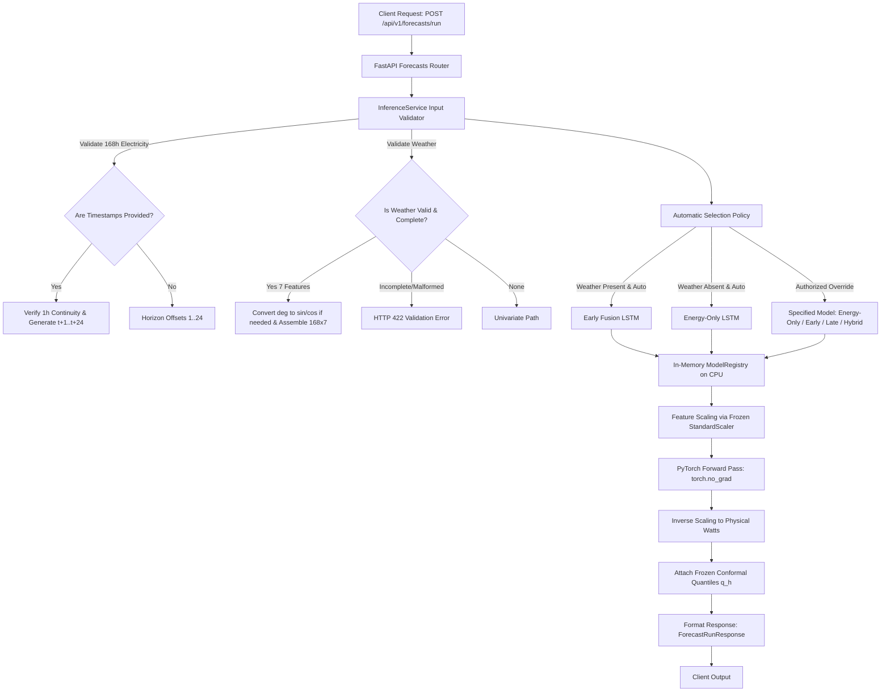

# Step 2 Report: Live Forecast Service and Inference API

**Project:** Reliable Multimodal Household Energy Forecasting Under Degraded Weather Information  
**Implementation Date:** October 11, 2026  
**Deliverable:** `outputs/reports/step2_live_inference_report.md`  
**Endpoint Exposed:** `POST /api/v1/forecasts/run`  
**Status:** Successfully Implemented & Fully Verified (38/38 Tests Passing)

---

## 1. Architecture Overview

The live forecast inference service establishes the first genuine end-to-end inference path from arbitrary user history to calibrated 24-hour electricity predictions in Watts, while strictly preserving the existing research pipeline and offline artifacts.

### Architectural Principles:
1. **In-Memory Model Registry (`ModelRegistry`):** Checkpoints are safely loaded once on CPU (`map_location="cpu"`) into their respective PyTorch `nn.Module` classes and cached in eval mode (`model.eval()`).
2. **Strict Scaling Integrity:** Numerical inputs are normalized using the frozen `energy_scaler.pkl` and `weather_scaler.pkl`. Scalers are never refit on incoming user requests.
3. **Horizon-Specific Conformal Uncertainty:** Frozen calibration quantiles $\hat{q}_h$ ($h=1..24$) calculated during Step 9 on 587 clean calibration windows ($\alpha = 0.10$, 90% nominal coverage) are applied to provide symmetric prediction intervals $[L_h, U_h] = [\hat{y}_h - \hat{q}_h, \hat{y}_h + \hat{q}_h]$ and non-negative clipped intervals $[L_{\text{clipped}}, U]$.

---

## 2. Input Contract

### 2.1 Endpoint
`POST /api/v1/forecasts/run`

### 2.2 Request Schema (`ForecastRunRequest`)

| Field | Type | Required | Description & Validation Rules |
| :--- | :--- | :--- | :--- |
| `electricity_active_power` | `List[float]` | **Yes** | Exactly 168 consecutive hourly active power observations in Watts. Must be non-empty, finite numbers (no NaN or Inf). |
| `timestamps` | `List[str]` | Optional | Optional list of 168 datetime strings matching electricity observations. If provided, must follow strictly consecutive 1-hour spacing. |
| `weather` | `WeatherSeriesInput` / `Dict` / `List[Dict]` | Optional | 168 hourly observations across 7 meteorological variables. Supports either direct sin/cos wind components or raw meteorological degrees `deg` $\in [0, 360]$. |
| `model` | `str` | Optional | Default `"auto"`. Authorized explicit overrides: `"energy_only"`, `"early_fusion"`, `"late_fusion"`, `"hybrid_fusion"`. Unapproved models are rejected. |

### 2.3 Required Audited Weather Features
When weather is provided, all 7 features must be present in the following audited ordering:
1. `temp`: Hourly temperature (°C)
2. `feels_like`: Hourly perceived temperature (°C)
3. `humidity`: Hourly relative humidity (%)
4. `pressure`: Hourly atmospheric pressure (hPa)
5. `speed`: Hourly wind speed (m/s)
6. `wind_sin`: Circular sine of wind direction ($\sin(\text{deg} \cdot \pi / 180)$)
7. `wind_cos`: Circular cosine of wind direction ($\cos(\text{deg} \cdot \pi / 180)$)

*Automatic Wind Conversion:* If callers provide `deg` instead of `wind_sin` and `wind_cos`, the service automatically computes circular decomposition before scaling.

---

## 3. Automatic Selection Policy

The research evaluates the four architectures as parallel scientific candidates and does not establish an adaptive meta-classification algorithm. To avoid fabricating an unvalidated dynamic routing rule, the service implements a conservative, transparent baseline:

1. **When Complete Valid Weather is Provided (`model="auto"`):**
   - **Selected Model:** **Early Fusion**
   - **Selection Rationale:** Early Fusion demonstrated the lowest clean test MAE (71.64 W) and lowest Winkler Interval Score (338.56) in the verified research benchmarks.
2. **When Weather is Absent (`model="auto"`):**
   - **Selected Model:** **Energy-Only**
   - **Selection Rationale:** Operates natively and exclusively on active power history without requiring weather observations.
3. **When Weather is Partial, Malformed, or Incomplete:**
   - The service rejects the request with an HTTP 422 validation error, preventing silent degradation or uncalibrated fallback.
4. **Authorized Overrides:**
   - Callers can explicitly request `"late_fusion"` or `"hybrid_fusion"` if complete weather history is supplied. If an override specifies a weather-dependent model without weather observations, an HTTP 422 error is returned.
5. **Transparency Disclaimer:**
   Every API response explicitly reports:
   > *"Clean-test performance does not guarantee optimal performance for every new household or under arbitrary distribution shifts."*

---

## 4. Conformal Uncertainty and Theoretical Limitations

### What is Supported and Returned:
- **Horizon-Specific Intervals ($h=1..24$):**
  $$L_h = \hat{y}_h - \hat{q}_h, \quad U_h = \hat{y}_h + \hat{q}_h$$
- **Non-Negative Clipped Lower Bound:**
  $$L_{\text{clipped}, h} = \max(0.0, L_h)$$
- **Prediction Interval Width ($\text{MPIW}_h$):**
  $$\text{Width}_h = U_h - L_h = 2 \cdot \hat{q}_h$$
- **Nominal Coverage Guarantee:** 90.0% ($\alpha = 0.10$).

### Fundamental Statistical Limitations:
1. **Marginal vs. Conditional Validity:**
   Split conformal prediction provides a **marginal (population-level)** guarantee across calibration and test distributions:
   $$\mathbb{P}(Y_{t+h} \in [L_h, U_h]) \ge 1 - \alpha$$
   It does **not** guarantee 90% coverage conditionally for any individual household, particular season, or under severe sensor degradation.
2. **Future Ground Truth Unknown:**
   Empirical coverage ($\text{PICP}$), Absolute Coverage Error ($\text{ACE}$), and Winkler Interval Scores cannot be computed at inference time because future active power $Y$ has not occurred yet.

---

## 5. Files Created and Modified

| File | Status | Description |
| :--- | :--- | :--- |
| [`backend/app/services/inference_service.py`](file:///e:/reliable-household-energy-forecasting/backend/app/services/inference_service.py) | **Created** | Core live inference service: `ModelRegistry`, 168-hour validation, circular wind transformation, feature scaling, PyTorch CPU execution, inverse scaling, and conformal bounds. |
| [`backend/app/schemas/forecasts.py`](file:///e:/reliable-household-energy-forecasting/backend/app/schemas/forecasts.py) | **Modified** | Added `WeatherSeriesInput`, `ForecastRunRequest`, `ConformalIntervalStep`, `ModelMetadataInfo`, and `ForecastRunResponse`. |
| [`backend/app/routers/forecasts.py`](file:///e:/reliable-household-energy-forecasting/backend/app/routers/forecasts.py) | **Modified** | Exposed `POST /api/v1/forecasts/run` with full validation and OpenAPI documentation. |
| [`backend/tests/test_live_inference_api.py`](file:///e:/reliable-household-energy-forecasting/backend/tests/test_live_inference_api.py) | **Created** | 12 comprehensive unit and integration tests covering all valid/invalid permutations. |
| [`outputs/reports/step2_live_inference_report.md`](file:///e:/reliable-household-energy-forecasting/outputs/reports/step2_live_inference_report.md) | **Created** | Comprehensive Step 2 architecture, contract, and audit report. |

---

## 6. Test Battery and Verification Results

### 6.1 Live Inference Test Suite (`backend/tests/test_live_inference_api.py`)
- `test_forecast_energy_only_auto_selection`: **PASSED** (24 predictions in Watts, conformal bounds, no weather).
- `test_forecast_early_fusion_auto_selection`: **PASSED** (24 predictions, Early Fusion auto-selected with weather).
- `test_forecast_with_wind_direction_degrees`: **PASSED** (Automatic `deg` $\to$ `sin`/`cos` transformation verified).
- `test_forecast_without_timestamps`: **PASSED** (Clean integer horizon steps 1..24 without timestamps).
- `test_explicit_overrides_late_and_hybrid_fusion`: **PASSED** (Late Fusion and Hybrid Fusion execute correctly).
- `test_unapproved_model_override_rejected`: **PASSED** (HTTP 422 on unapproved architecture).
- `test_weather_dependent_model_without_weather_rejected`: **PASSED** (HTTP 422 on multimodal override without weather).
- `test_electricity_length_mismatch`: **PASSED** (HTTP 422 on lengths $\ne 168$).
- `test_electricity_non_finite_values`: **PASSED** (HTTP 422 on NaN, Inf, and None).
- `test_timestamps_frequency_discontinuity`: **PASSED** (HTTP 422 on non-hourly irregular intervals).
- `test_weather_missing_feature`: **PASSED** (HTTP 422 on omitted weather columns).
- `test_weather_length_mismatch`: **PASSED** (HTTP 422 on weather length $\ne 168$).

**Result:** `12 tests passed in 2.618s (OK)`

### 6.2 Entire Backend Test Suite
Executed non-server command: `python -m unittest discover -s backend/tests`
- `test_health.py`: 4 tests passed.
- `test_artifact_endpoints.py`: 16 tests passed.
- `test_model_inference_audit.py`: 6 tests passed.
- `test_live_inference_api.py`: 12 tests passed.

**Result:** `38 tests passed in 4.031s (OK, 100% pass rate)`.

### 6.3 Frontend Production Build
Executed non-server command: `npm run build` in `frontend/`
- TypeScript compilation (`tsc -b`): **Clean, 0 errors**.
- Vite production bundle: **Built in 28.00s (`dist/assets/index-D9tdg2Y_.js` 699.55 kB)**.

---

## 7. Remaining Limitations and Next Steps

1. **No Frontend Upload UI Yet:** The backend API `POST /api/v1/forecasts/run` is ready, but the React frontend does not yet have a file-upload or forecast runner interface (scope intentionally deferred to subsequent steps).
2. **Stateless Execution:** Predictions are generated in real-time and returned directly to the client; no database persistence or run-history table is implemented yet.
3. **Strict Input Requirement:** The service strictly requires 168 continuous hourly observations. It does not perform automated interpolation for missing interior hours.
